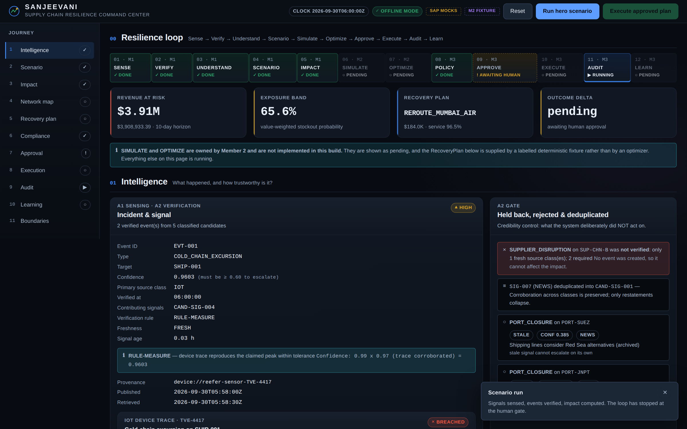
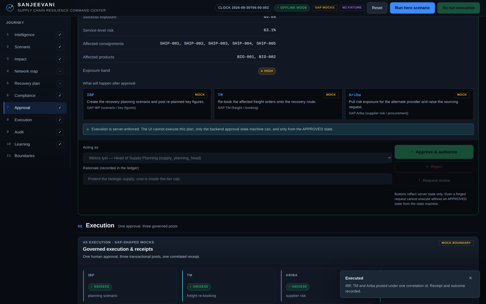
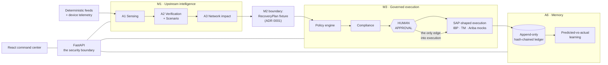

# SANJEEVANI

[](https://github.com/humoge7502/sanjeevani/actions/workflows/ci.yml)

**A governed closed-loop recovery system for pharmaceutical supply networks.**

> AI detects and understands a disruption, deterministic systems evaluate the
> consequences, a human authorizes the consequential action, SAP-shaped systems
> execute it, and the outcome becomes auditable learning.

This repository implements the **whole loop**: upstream intelligence
(sense → verify → scenario → network impact), simulation and recovery
optimization (M2), and governed execution (policy → compliance → human approval →
SAP-shaped execution → audit → learn).

The question this system answers is not "what happened?" — sensing is a solved
problem. It is: **"Can we safely execute the proposed recovery, and can we prove
afterwards why we did?"**

Three things were added after the first vertical slice, each kept **opt-in** so the
demo's documented, byte-reproducible numbers are untouched:

| Added | Turn it on | Read |
|---|---|---|
| A **real recovery optimizer** and a deterministic digital twin — a multi-objective binary program solved by PuLP/CBC and cross-checked by exhaustive enumeration | `SANJEEVANI_PLAN_PROVIDER=optimizer` | [docs/m2-optimizer.md](docs/m2-optimizer.md) · [ADR 0010](docs/decisions/0010-m2-is-implemented-and-opt-in.md) |
| A **deterministic discrete-event cross-check** — finite berths, closure unions, topology-derived arrivals; its disagreements with the twin are reported, never averaged | `SANJEEVANI_M2_DES=true` (hard constraint) | [docs/m2-des.md](docs/m2-des.md) · [ADR 0015](docs/decisions/0015-the-des-is-a-cross-check-not-a-second-opinion.md) |
| **Authentication, roles and tenancy** — the approver comes from a signed token, not a request body | `SANJEEVANI_AUTH_ENABLED=true` + a ≥32-byte secret | [ADR 0011](docs/decisions/0011-authentication-is-opt-in.md) |
| A **trained disruption-duration forecaster** — advisory only, with a dependency-free runtime | `forecasting.enabled: true` | [docs/forecasting.md](docs/forecasting.md) · [ADR 0012](docs/decisions/0012-trained-model-is-exported-not-pickled.md) |

---

## Quick start

```bash
# 1. Dependencies
python -m pip install -r requirements-dev.txt
npm --prefix frontend install
(cd frontend && npx playwright install chromium)   # only needed for the browser tests

# 2. Pre-flight: proves the environment, the seed data and the
#    governance invariant are all intact (no server required)
python scripts/health.py

# 3. The whole loop, one command, offline, no server
python scripts/demo.py
```

For the full command center UI:

```bash
bash scripts/dev.sh          # backend on :8787 + frontend on :5173
```

Then open <http://127.0.0.1:5173> and follow **Reset → Run hero scenario →
Approve → Execute → Audit → Learn**.

### The hero scenario

A maritime corridor closure at Bab-el-Mandeb plus a 2–8 °C biologics excursion
on the consignment waiting at the chokepoint, against a deterministic 12-node
synthetic pharmaceutical network.

| | 3-day horizon | 10-day horizon | 30-day horizon |
|---|---|---|---|
| Revenue at risk | $852,208 | **$3,908,933** | $5,111,325 |
| Stockout probability | 1.56 % | **65.59 %** | 90.46 % |
| Service-level risk | 0.19 % | **63.14 %** | 88.02 % |

The hero consignment — `SHIP-001`, **Trastuzumab 440mg** (BIO-002), $2.856M, bound
for the EU market on `LANE-MUM-BIO-EU` and stranded at `PORT-SUEZ` — carries a
**63.21 %** stockout probability at the 10-day horizon, with **26.67 %** of the
consignment condemned by the modelled temperature excursion. Every one of those
figures is traceable in the UI to its arithmetic:

```
remaining corridor fraction 0.400 of 12d delay -> 4.80d
outage gap = min(H=10d, duration 10d + delay 4.80d) = 10.00d
cover 5d -> shortfall 5.00d
p_stockout = 1 - exp(-5.00/5) = 0.6321
consigned fraction 0.2667 condemned from device trace TVE-4417
```

## What it looks like

Real captures of the running command center (Playwright driving the app on
:8787, no staging build — the same view `bash scripts/dev.sh` gives you).

| The human gate | The governed loop, closed |
|---|---|
|  |  |

**Left** — the moment the system deliberately stops. M1 intelligence is
complete, the policy engine and compliance checks have run, and the approval
console is the only way forward. The actor dropdown is not cosmetic: an
approver whose role does not match the plan's requirement is refused with
403 by the backend, not hidden by the UI.

**Right** — one approval later. Three transactional SAP-shaped posts with a
correlation ID, one receipt, the audit timeline showing every stage's hash
(the chain verifies intact), and the predicted-vs-actual learning signal.
Every number on screen traces to a ledger record you can read in the same
table.

---

## The loop

```
M1  Sense ──► Verify ──► Understand ──► Scenario ──► Impact
                                                       │
M2           Simulate ──► Optimize ◄───────────────────┘   (real, opt-in:
                                                           digital twin + MILP)
                                             │
M3  Policy ──► Compliance ──► HUMAN APPROVAL ──► Execute ──► Audit ──► Learn
```

### What each agent does

| Agent | Owns | Implementation |
|---|---|---|
| **A1 Sensing** | Normalize, classify, score, provenance, freshness | `backend/agents/sensing.py` |
| **A2 Verification + Scenario** | Dedup, 2-source rule, measurement corroboration, 3/10/30-day scenarios | `backend/agents/verification.py` |
| **A3 Network Impact** | Graph propagation, stockout, revenue at risk, service level | `backend/agents/impact.py` |
| **A4 Logistics/Inventory/Optimization** | Deterministic digital twin + multi-objective recovery optimizer + discrete-event cross-check + contended hub inventory | `backend/m2/` |
| **A5 Compliance + HITL** | Policy engine, risk tiering, approval state machine, execution | `backend/governance/` |
| **A6 Audit + Learning** | Append-only hash-chained ledger, predicted-vs-actual, calibration signals | `backend/audit/`, `backend/learning/` |

---

## Commands

Every command below exists in this repository. Nothing is aspirational.

| Command | Purpose |
|---|---|
| `python scripts/health.py` | Pre-flight check. Run before every rehearsal. |
| `python scripts/demo.py` | Full loop: reset → run → approve → execute → audit → learn |
| `python scripts/demo.py --to-gate` | Stop at the human approval gate |
| `python scripts/demo.py --json` | Machine-readable transcript |
| `SANJEEVANI_PLAN_PROVIDER=optimizer python scripts/demo.py` | The same loop with M2's **real optimizer** instead of the fixture |
| `python scripts/make_identity.py --demo` | Regenerate the demo account roster (`config/identity.yaml`) |
| `python scripts/train_forecasting_model.py` | Retrain the disruption-duration model (needs `requirements-ml.txt`) |
| `python scripts/reset.py` | Clear ledger, approvals and SAP mock logs |
| `bash scripts/dev.sh` | Backend + frontend together (dev servers, HMR) |
| `python scripts/serve.py` | **Production entrypoint**: serves the API *and* the built UI on one port |
| `docker compose up --build` | Same thing, containerised: UI + API on :8787 |
| `bash scripts/verify.sh` | Everything: nine gates — health, compile, lint, types, tests, browser, build |
| `python -m ruff check .` | Python lint (also a gate in `verify.sh`, or `npm run lint`) |
| `python -m mypy backend scripts` | Python typecheck (also a gate in `verify.sh`, or `npm run typecheck`) |
| `python -m pytest` | Backend suite (396 tests) |
| `python -m pytest -m redteam` | Adversarial governance- and auth-bypass suite |
| `python -m pytest -m contract` | Frozen-contract suite |
| `npm --prefix frontend run test` | Frontend unit tests (46) |
| `npm --prefix frontend run test:browser` | **Real Chromium**: hero journey, governance, accessibility (48) |
| `npm --prefix frontend run test:browser:headed` | Same, with a visible browser — useful in a rehearsal |
| `npm --prefix frontend run build` | Production build |
| `npm run api` / `npm run web` | Start each half (ports 8787 / 5173) |

### Is the optimizer, auth or the model on?

```bash
curl -s localhost:8787/api/health       | python -m json.tool   # auth + rate limiting + m2 provider
curl -s localhost:8787/api/mock-boundaries | python -m json.tool   # which M2 provider is live
curl -s localhost:8787/api/forecasting  | python -m json.tool   # the trained model's provenance
curl -s localhost:8787/api/state        | python -m json.tool   # → "m2": the whole solver trace
curl -s localhost:8787/metrics                                  # Prometheus
```

---

## Architecture

```
sanjeevani/
├── config/                     settings · policy rulebook · scenario library ·
│                               recovery catalogue · identity roster
├── data/                       deterministic seed: network · SKUs · consignments · feeds ·
│   └── ml/                     telemetry · the trained forecaster's JSON artifact
├── backend/
│   ├── contracts/              THE SIX FROZEN INTEGRATION OBJECTS
│   ├── graph/                  12-node network + derived directed graph
│   ├── agents/                 M1: sensing · verification · impact · telemetry · pipeline
│   ├── m2/                     M2: digital twin · optimizer · DES cross-check ·
│                               hub inventory · fixture + optimizer providers
│   ├── forecasting/            the trained duration prior — pure-Python inference, no ML stack
│   ├── governance/             M3: policy engine · compliance · approval state machine
│   ├── sap/                    M3: SAP-shaped IBP/TM/Ariba mocks + execution orchestrator
│   ├── audit/                  M3: append-only hash-chained decision ledger
│   ├── learning/               M3: predicted-vs-actual reconciliation
│   ├── persistence/            M3: SQLite mirror of the ledger (queryable, never authoritative)
│   ├── security/               identity · tokens · principals · CSP headers · rate limiting
│   ├── observability/          metrics · structured JSON logs · request correlation
│   ├── api/                    FastAPI surface (the security boundary) + middleware
│   └── orchestrator.py         the loop coordinator
├── frontend/                   React + TypeScript command center
│   └── e2e/                    Playwright: hero journey · governance · axe-core a11y
├── tests/                      396 tests: unit · contract · integration · e2e · redteam
├── scripts/                    health · demo · reset · dev · verify · serve ·
│                               make_identity · train_forecasting_model
├── Dockerfile                  multi-stage build -> one image (API + built UI)
├── docker-compose.yml          one-command deployment with a persistent ledger volume
└── docs/                       architecture · contracts · boundaries · optimizer · forecasting …
    └── evidence/               authoritative real-data package: 477 sourced records + frozen schemas
```

### How a decision flows



Every state-changing request travels UI → API → orchestrator → approval state
machine. The UI cannot set a state; it can only request that the backend move
one, and the machine refuses what governance refuses.

### Documentation map

| Document | Answers |
|---|---|
| [`docs/architecture.md`](docs/architecture.md) | How the loop is structured and where the boundaries are |
| [`docs/contracts.md`](docs/contracts.md) | The six frozen integration objects |
| [`docs/mock-boundaries.md`](docs/mock-boundaries.md) | **What is real, deterministic, simulated and mocked** |
| [`docs/m2-optimizer.md`](docs/m2-optimizer.md) | **The digital twin and the recovery optimizer**: the program, the two solvers, the results worth knowing |
| [`docs/m2-des.md`](docs/m2-des.md) | **The discrete-event cross-check**: berths, closure unions, the 70.8-hour blind spot, and why the two models are never averaged |
| [`docs/forecasting.md`](docs/forecasting.md) | **The one trained model**: its features, its measured quality, and why it cannot touch a number |
| [`docs/demo-runbook.md`](docs/demo-runbook.md) | The 10-minute presentation, minute by minute |
| [`docs/security-threat-model.md`](docs/security-threat-model.md) | STRIDE review with mitigations and accepted risks |
| [`docs/design-system.md`](docs/design-system.md) | Tokens, hierarchy, motion, accessibility |
| [`docs/performance-budget.md`](docs/performance-budget.md) | Measured budgets and how to reproduce them |
| [`docs/deployment.md`](docs/deployment.md) | **How to deploy it**: the single-image layout, config, ledger volume, scale limits |
| [`docs/skills-registry.md`](docs/skills-registry.md) | Which external skills were evaluated and why none were installed |
| [`docs/research-evidence.md`](docs/research-evidence.md) | Sources that changed the implementation, fact vs inference |
| [`docs/competitive-benchmark.md`](docs/competitive-benchmark.md) | Everstream · Kinaxis · SAP IBP, vendor claims labelled |
| [`docs/judge-defense.md`](docs/judge-defense.md) | The hard questions and the honest answers |
| [`docs/audit/2026-10-comprehensive-audit-and-roadmap.md`](docs/audit/2026-10-comprehensive-audit-and-roadmap.md) | **The audit that produced the changes below**: every issue with severity, effort and dependencies |
| [`docs/evidence/`](docs/evidence/) | **The real-data package**: 477 records with page-level provenance, the six frozen schemas, and the raw JSON of all 58 web searches |
| [`docs/decisions/`](docs/decisions/) | Fifteen ADRs, each with its downsides listed |

---

## The governance invariant

Execution is only reachable from an approved state, and only one module in the
codebase can set that state.

```
RECEIVED → POLICY_CHECKING → COMPLIANCE_CHECKING → APPROVAL_REQUIRED
                                                          │
                            ┌─────────────────────────────┼──────────────┐
                            ▼                             ▼              ▼
                         APPROVED                     REJECTED      REVIEW_REQUESTED
                            │
                            ▼                    ← THE ONLY EDGE INTO EXECUTION
                        EXECUTING → EXECUTED → AUDITED → COMPLETED
```

Enforced in the backend, not the UI. `POST /api/plans/{id}/execute` from any
other state returns `409 EXECUTION_BLOCKED` — proven by 26 adversarial tests in
`tests/redteam/`, including an architectural guard that fails if a second module
ever gains the ability to transition a plan into `APPROVED`.

---

## Honest boundaries

This is an MVP. Read [`docs/mock-boundaries.md`](docs/mock-boundaries.md) for the
full inventory. In short:

| | |
|---|---|
| **Real** | Graph traversal and impact arithmetic · telemetry analysis · **the digital twin, the recovery optimizer and the discrete-event cross-check** · the contended hub-inventory ceiling · policy engine · approval state machine · hash-chained ledger · the whole API and UI |
| **Deterministic** | The 12-node network, 12 SKUs, 6 lanes, 8 consignments · scripted signal feeds · device telemetry · post-execution observations · a frozen scenario clock so every run is reproducible · **the twin itself: closed-form, no sampling, no random seed — and the DES: a deterministic SimPy event heap, likewise no sampling and no seed** |
| **Configured** | The recovery **action catalogue** (`config/recovery_options.yaml`) — the option space and its coefficients are this project's estimates, not measured history |
| **Simulated** | IoT telemetry source · post-execution outcome feedback · trade/sanctions screening lists |
| **Mocked** | SAP IBP / TM / Ariba surfaces · the `RecoveryPlan` **fixture** (default; `SANJEEVANI_PLAN_PROVIDER=optimizer` selects the real solve) |
| **Off by default** | Authentication (complete and tested, disabled so the offline demo is unchanged) · the training date prior (`forecasting.enabled: false`) · the SQLite ledger mirror |
| **Not built** | Routing/scheduling (OR-Tools) · real SAP connectors · GNN cascade prediction · rolling-horizon re-optimisation · inventory *optimisation* (reorder policies, safety stock — the contended hub ceiling is modelled) · multi-tenancy isolation in the approval registry |
| **AI usage** | **No language model participates in any number.** An `llm_enabled` flag exists, is off, and could only ever add narrative text. There is exactly one trained model — the advisory duration forecaster — and it cannot reach a number unless explicitly enabled. |

The recovery action catalogue's coefficients are engineering estimates, and the
forecaster's training rows are synthetic (generated from cited evidence ranges).
Both are labelled as such everywhere they appear. In the default configuration,
**no optimizer result reaches a number either** — the fixture is what runs.

Compliance checks are labelled `configured_policy`, `simulated_rule` or
`illustrative_check` in the UI and in the API payload. Nothing here is legal or
regulatory advice and nothing claims certification.

### Four results worth knowing, because someone will ask

1. **The Cape re-route is worse than doing nothing** inside a 10-day window. It adds
   three days of transit, and because the closure duration already equals the
   horizon the extra delay buys no coverage — it just costs money.
2. **No uniform recovery policy is admissible at all.** Waiting and quarantine lose
   the service floor; air uplift and emergency sourcing breach the budget cap. The
   optimum is a per-consignment **mix**, which is exactly what a planner cannot
   compute by hand.
3. **The trained model is not consulted unless you ask it to be.** It runs, its
   prediction is recorded as evidence, and the number in the ledger is still the
   signal claim.
4. **The twin has a 70.8-hour blind spot, and the system says so.** Under a uniform
   `WAIT` policy the closed-form twin prices recovery at 336 h; the discrete-event
   cross-check says the corridor is not clear for **406.8 h**, because the last
   consignment is 16.2 days out and must queue behind the reopen. The two numbers
   are reported side by side — never averaged.

All four are asserted by tests rather than described.
`tests/unit/test_m2_optimizer.py` for 1 and 2;
`tests/unit/test_forecasting.py` for 3;
`tests/unit/test_m2_des.py` for 4.

---

## Deployment

It ships as **one deployable unit**: a multi-stage image where the API also
serves the built command center, so there is no second web server and no CORS.

```bash
docker compose up --build      # -> http://localhost:8787
```

Full guide: [`docs/deployment.md`](docs/deployment.md). The parts worth knowing
up front:

- **Multi-stage build.** `npm run build` (which is `tsc -b && vite build`) runs in
the build stage, so a type error **fails the image build** instead of shipping.
Only `frontend/dist` crosses into the runtime stage — `node` is absent from the
final image.
- **~235 MB, non-root (UID 10001), `/app/runtime` declared a `VOLUME`.** The
  ledger is the only mutable state; without the volume the hash chain would be
  lost on every redeploy, making the tamper-evidence claim depend on never
  deploying.
- **The ledger survives a restart.** Verified with the volume mounted: after
  `docker restart`, 41 records rehydrate with the chain intact and the **same
  head hash**, and a new run continues the sequence `1..73` without a break. See
  [ADR 0009](docs/decisions/0009-ledger-rehydrates-from-disk-on-start.md).
- **One process, deliberately.** The orchestrator, approval machine and ledger are
  in-process singletons. More than one worker would fork approval state and
  duplicate ledger `seq` numbers. Horizontal scaling is a stated production
  requirement, not a hidden one. (The rate limiter and the SQLite mirror inherit
  the same constraint, and say so.)
- **`/api/health` probes the real app**, not a static file, and reports whether
  the ledger is `writable`, `rehydrated_from_disk`, whether any truncated lines
  were `skipped_malformed_lines`, whether any writes `failed`, the active M2
  provider, the auth posture, the rate-limiter budget, and whether the SQLite
  mirror agrees with the ledger.
- **Security headers and a nonce-based CSP are on by default.** Vite's inline
  module-preload shim gets the per-request nonce injected at serve time, so the
  policy does not need `'unsafe-inline'` for scripts. A contract test asserts the
  header nonce and the injected nonces match, and that they are never reused.
- **The runtime carries no numeric stack.** The trained forecaster is shipped as
  portable JSON and evaluated in pure Python, so `numpy`, `scipy`, `pandas` and
  `scikit-learn` stay in `requirements-ml.txt` (training only) and off the request
  path. A test enforces that in a clean interpreter.

Production switches, all off by default and all documented in
[`.env.example`](.env.example):

```bash
SANJEEVANI_AUTH_ENABLED=true          # require signed tokens; approver comes from the token
SANJEEVANI_JWT_SECRET=<32+ bytes>     # required when auth is on; a weak secret fails startup
SANJEEVANI_PLAN_PROVIDER=optimizer    # run M2's real optimizer instead of the fixture
SANJEEVANI_AUDIT_MIRROR=true          # maintain the queryable SQLite ledger mirror
SANJEEVANI_LEDGER_DURABILITY=fsync    # none | flush | fsync
SANJEEVANI_CORS_ORIGINS=https://sanjeevani.example.com
```

CI ([`.github/workflows/ci.yml`](.github/workflows/ci.yml)) runs the *same*
`bash scripts/verify.sh` gate as a developer does — one definition, two
environments — then builds the image and drives the governance boundary inside
the running container.

---

## Testing

```
396 passed  (backend: unit · contract · integration · e2e · red team)
 46 passed  (frontend: 30 pure logic · 16 static accessibility guards)
 48 passed  (browser: 24 in real Chromium × 2 viewports)
```

The backend markers **overlap** — the integration cases are marked inside the
e2e module, so they are counted by both. The suite total is the honest number.
`verify.sh` also runs `ruff` and `mypy` as gates, and a missing dev tool fails the
run rather than being skipped: "lint passes" is only meaningful if lint actually ran.

### The adversarial suites

The governance suite attempts execution before approval, execution after rejection,
approval with an insufficient role, approval as an unknown actor, double approval,
double execution, compliance-bypass, state-machine bypass, forged approval fields,
malformed plans, ledger tampering, prompt injection through feed text, and an
unavailable M2 provider. Every test asserts that the attack FAILED.

The authentication suite drives the **real ASGI app** through `TestClient` with
auth enabled: unauthenticated reads/approval/execution, a forged signature, an
`alg: none` token, an expired token, a role claim taken from the body instead of the
token, a non-admin reset, an oversized body, an approval flood, a wildcard actor id
and a hostile request id. Same rule: a passing test means the attack failed.

```bash
python -m pytest -m redteam -v
```

### The suite had been deleting the ledger

Found while making the system deployable, and worth recording because it is the
failure mode that tests are supposed to prevent.

`orchestrator.reset()` calls `ledger.reset()`, whose default truncates the ledger
file — and several tests call `reset()` to exercise normal behaviour. With the
runtime directory pointed at the repository, **running `pytest` deleted the
developer's on-disk audit ledger**: a 43-record chain came back as 4 lines.
Nothing failed. A suite quietly destroying application state looks exactly like a
suite passing.

`tests/conftest.py` now redirects the runtime directory to a per-session temp
directory, and `tests/unit/test_runtime_isolation.py` fails the build if that
redirect is ever removed. Re-running the suite now leaves the real ledger
untouched at 43 lines.

The static accessibility guards earned their place immediately: on first run they
found that `.skip-link` was styled in CSS and `<main id="main">` existed, but
**the anchor was never rendered** — a dead skip link that no review had caught.

But a static guard can only check that CSS is *declared*. It cannot tell you the
rendered page is usable. So the browser suite runs the whole product in Chromium
and puts it through **axe-core** across the WCAG 2.1 A/AA rule set, plus keyboard,
reduced-motion and responsive checks at 1600 px and 1120 px.

On its first real run that suite found **five defects no prior review had caught**:

| Found | Detail |
|---|---|
| **Contrast, pervasively** | `--text-muted` measured 4.43:1 and `--text-faint` 2.62:1 against the panel surface — both below the 4.5:1 floor, across KPI labels, table headers and the audit timeline |
| **Nested interactive controls** | The network map was `role="img"` containing twelve `role="button"` nodes: an atomic container holding focusable children, so assistive tech would flatten controls that were still in the tab order |
| **Unscrollable-by-keyboard region** | The learning scorecard table overflows horizontally with no way to scroll it without a pointer |
| **Scrollable HUD at narrow widths** | Twelve loop stages at a 92 px minimum overflow 1120 px, so stages 11 and 12 were unreachable by keyboard |
| **Duplicate React key** | The side rail reused `key="LEARN"` for both Learning and Boundaries, logging a duplicate-key warning on every render |

All five are fixed, and the suite fails the build if any returns. Full list in
[`docs/design-system.md`](docs/design-system.md).

---

## Source material

The specification this build implements lives in
[`docs/source/`](docs/source/) — text extractions of the SANJEEVANI unified
dossier and the three-member workflow handoff (originals archived verbatim in
[`docs/evidence/source_pdfs/`](docs/evidence/source_pdfs/)).
[`docs/research-evidence.md`](docs/research-evidence.md)
records which external sources materially changed the implementation, with the
distinction between **fact**, **inference** and **hypothesis** made explicit.

---

## License / attribution

Code is released under the [MIT License](LICENSE) — see [`LICENSE`](LICENSE).
Third-party names (SAP, IBP, TM, Ariba, HANA, Joule) remain trademarks of
SAP SE; no SAP tenant, service or credential is used or contacted anywhere in
this repository.

Prototype built for SAP Hackfest 2026.
